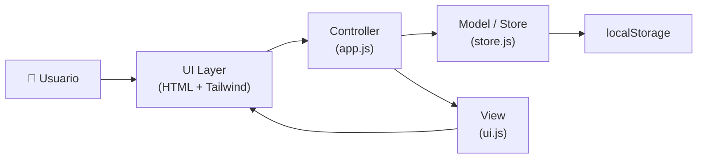
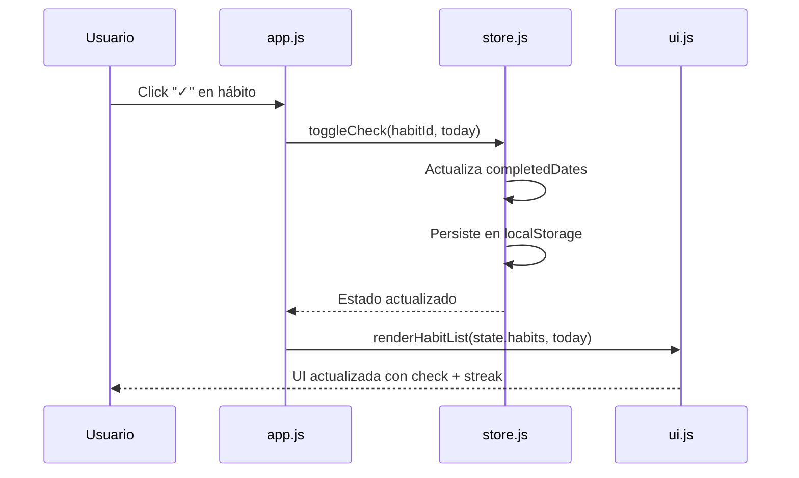
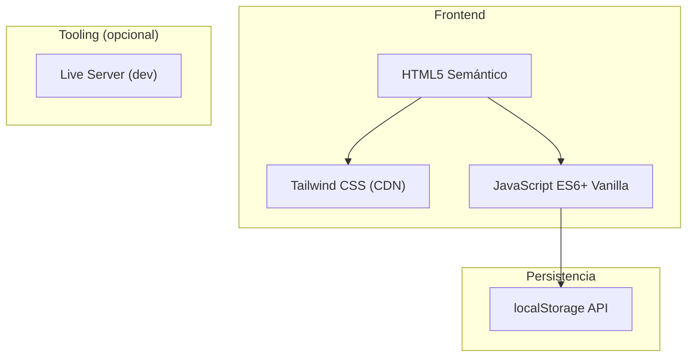

# 🏗️ Arquitectura — Pápakukua (MVP)

> Habit Tracker minimalista y moderno con persistencia local.

---

## 1. Visión General

Pápakukua es una **Single-Page Application (SPA)** que corre 100% en el navegador, sin backend.  
Los datos se persisten en `localStorage` y la UI se construye con **HTML5 + Tailwind CSS + JavaScript Vanilla** siguiendo un patrón modular **MVC ligero**.



---

## 2. Estructura de Archivos

```
Pápakukua/
├── index.html              # Punto de entrada — shell de la SPA
├── css/
│   └── styles.css          # Estilos custom + overrides de Tailwind
├── js/
│   ├── app.js              # Controller — lógica de orquestación y eventos
│   ├── store.js            # Model — CRUD, streaks, persistencia localStorage
│   ├── ui.js               # View — renderizado del DOM y componentes
│   └── utils.js            # Helpers puros (fechas, IDs, formateo)
├── assets/
│   └── icons/              # Íconos SVG inline o favicon
├── prompt.md               # Prompt original del proyecto
├── arquitectura.md          # ← Este documento
└── README.md               # Instrucciones de arranque rápido
```

---

## 3. Capas de la Arquitectura

### 3.1 Model / Store (`store.js`)

Responsable de toda la lógica de datos y persistencia.

| Responsabilidad | Detalle |
|---|---|
| **Persistencia** | Lee/escribe en `localStorage` bajo la clave `papakukua_data` |
| **CRUD de hábitos** | `addHabit(name, category)`, `deleteHabit(id)` |
| **Check diario** | `toggleCheck(habitId, dateStr)` — marca/desmarca un hábito para una fecha |
| **Streaks** | `getStreak(habitId)` — calcula la racha actual de días consecutivos |
| **Export del estado** | `getState()` — retorna el estado completo para la View |

#### Modelo de Datos (localStorage)

```json
{
  "habits": [
    {
      "id": "h_1a2b3c",
      "name": "Meditar 10 min",
      "category": "Salud",
      "createdAt": "2026-11-11",
      "completedDates": ["2026-11-09", "2026-11-10", "2026-11-11"]
    }
  ],
  "settings": {
    "theme": "dark"
  }
}
```

> [!IMPORTANT]
> `completedDates` es un array de strings ISO `YYYY-MM-DD`. Las rachas se calculan iterando hacia atrás desde hoy buscando fechas consecutivas presentes en el array.

---

### 3.2 View / UI (`ui.js`)

Renderiza el DOM a partir del estado. **No muta datos directamente.**

| Componente | Descripción |
|---|---|
| `renderHabitList(habits, today)` | Lista principal de hábitos con checkbox y streak badge |
| `renderAddHabitForm()` | Formulario modal/inline para crear hábitos |
| `renderEmptyState()` | Mensaje motivacional cuando no hay hábitos |
| `applyTheme(theme)` | Alterna clases de Tailwind para dark/light mode |
| `showToast(message, type)` | Notificaciones efímeras de feedback |

---

### 3.3 Controller (`app.js`)

Orquesta Model y View. Registra los event listeners y media las acciones del usuario.



**Flujos principales:**

| Acción | Flujo |
|---|---|
| **Agregar hábito** | Form submit → `store.addHabit()` → `ui.renderHabitList()` |
| **Eliminar hábito** | Click delete → Confirm → `store.deleteHabit()` → `ui.renderHabitList()` |
| **Check/Uncheck** | Click checkbox → `store.toggleCheck()` → `ui.renderHabitList()` |
| **Cambiar tema** | Click toggle → `store.updateTheme()` → `ui.applyTheme()` |
| **Carga inicial** | `DOMContentLoaded` → `store.getState()` → `ui.renderHabitList()` + `ui.applyTheme()` |

---

### 3.4 Utilidades (`utils.js`)

Funciones puras sin side-effects:

- `generateId()` — Genera un ID único con `crypto.randomUUID()` o fallback.
- `getTodayStr()` — Retorna la fecha local como `YYYY-MM-DD`.
- `calculateStreak(completedDates)` — Dado un array de fechas, retorna el número de días consecutivos hasta hoy.
- `formatDate(dateStr)` — Formatea fechas para la UI.

---

## 4. Stack Tecnológico



| Componente | Tecnología | Justificación |
|---|---|---|
| **Markup** | HTML5 semántico | Accesibilidad, SEO-friendly, sin dependencias |
| **Estilos** | Tailwind CSS (CDN) | Utility-first, dark mode built-in, zero config |
| **Lógica** | JavaScript Vanilla (ES6+) | Sin bundler, módulos nativos (`type="module"`), cero overhead |
| **Persistencia** | `localStorage` | Offline-first, sin servidor, datos del usuario en su navegador |
| **Dev Server** | Live Server (VS Code) | Hot-reload para desarrollo rápido |

---

## 5. Diseño de UI / Componentes

### Layout Responsivo

```
┌──────────────────────────────────────────┐
│  🔥 Pápakukua            ☀️/🌙 Toggle   │  ← Header
├──────────────────────────────────────────┤
│                                          │
│  📅 Hoy: Miércoles 11 Nov 2026          │  ← Fecha actual
│                                          │
│  ┌─────────────────────────────────────┐ │
│  │ ✅ Meditar 10 min     🔥 5 días    │ │  ← Hábito (completado)
│  │    📁 Salud                         │ │
│  ├─────────────────────────────────────┤ │
│  │ ⬜ Leer 30 min        🔥 0 días    │ │  ← Hábito (pendiente)
│  │    📁 Desarrollo      🗑️           │ │
│  ├─────────────────────────────────────┤ │
│  │ ⬜ Ejercicio           🔥 12 días   │ │  ← Hábito (pendiente)
│  │    📁 Salud            🗑️           │ │
│  └─────────────────────────────────────┘ │
│                                          │
│  [ + Agregar hábito ]                    │  ← CTA
│                                          │
├──────────────────────────────────────────┤
│  Pápakukua © 2026                        │  ← Footer
└──────────────────────────────────────────┘
```

### Tema Oscuro / Claro

| Propiedad | Light | Dark |
|---|---|---|
| Background | `bg-gray-50` | `bg-gray-900` |
| Cards | `bg-white` | `bg-gray-800` |
| Texto primario | `text-gray-900` | `text-gray-100` |
| Acento | `text-orange-500` | `text-orange-400` |
| Bordes | `border-gray-200` | `border-gray-700` |

Se implementa con la clase `dark` en `<html>` y los modifiers `dark:` de Tailwind.

---

## 6. Algoritmo de Rachas (Streaks)

```
función calculateStreak(completedDates):
    ordenar completedDates descendente
    streak = 0
    fechaEsperada = HOY

    para cada fecha en completedDates:
        si fecha == fechaEsperada:
            streak += 1
            fechaEsperada = fechaEsperada - 1 día
        si no:
            romper

    retornar streak
```

> [!NOTE]
> Si el hábito **no** está marcado hoy, el algoritmo empieza buscando desde **ayer**, para no romper la racha prematuramente durante el día en curso.

---

## 7. API Interna (Contratos entre módulos)

### `store.js` — Exports

```javascript
export function getState()                        // → { habits: [], settings: {} }
export function addHabit(name, category)           // → habit object
export function deleteHabit(id)                    // → boolean
export function toggleCheck(habitId, dateStr)       // → habit object
export function updateTheme(theme)                 // → void
```

### `ui.js` — Exports

```javascript
export function renderHabitList(habits, todayStr)  // → void (muta DOM)
export function renderEmptyState()                 // → void
export function applyTheme(theme)                  // → void
export function showToast(message, type)           // → void
export function bindEvents(handlers)               // → void
```

### `utils.js` — Exports

```javascript
export function generateId()                       // → string
export function getTodayStr()                      // → "YYYY-MM-DD"
export function calculateStreak(completedDates)    // → number
export function formatDate(dateStr)                // → string
```

---

## 8. Decisiones Técnicas

| Decisión | Alternativa descartada | Razón |
|---|---|---|
| Vanilla JS | React/Vue/Svelte | MVP simple, sin overhead de framework ni build step |
| Tailwind CDN | CSS custom / Bootstrap | Rápido de prototipar, dark mode nativo, tamaño mínimo |
| `localStorage` | IndexedDB / SQLite (WASM) | Suficiente para un MVP, API simple y síncrona |
| ES Modules (`type="module"`) | Bundler (Vite/Webpack) | Soporte nativo en navegadores modernos, zero-config |
| IDs con `crypto.randomUUID()` | Auto-increment | Evita colisiones, preparado para futuras migraciones |

---

## 9. Evolución Futura (Post-MVP)

> [!TIP]
> Estas funcionalidades están **fuera del scope del MVP** pero la arquitectura las soporta.

| Feature | Capa afectada | Esfuerzo |
|---|---|---|
| Historial / Calendario visual | `ui.js` (nuevo componente) | Medio |
| Categorías con filtro | `ui.js` + `store.js` | Bajo |
| Export/Import JSON | `store.js` + `ui.js` | Bajo |
| Notificaciones (Service Worker) | Nuevo módulo `sw.js` | Alto |
| Sync con backend (Supabase/Firebase) | Reemplazar `store.js` | Alto |
| PWA (manifest + offline) | `manifest.json` + `sw.js` | Medio |
| Estadísticas y gráficas | Nuevo módulo `charts.js` | Medio |

---

## 10. Arranque Rápido

```bash
# No requiere instalación — solo un servidor de archivos estáticos

# Opción 1: VS Code Live Server
# → Click derecho en index.html → "Open with Live Server"

# Opción 2: Python
python -m http.server 3000

# Opción 3: Node.js
npx serve .
```

Abrir `http://localhost:3000` en el navegador. ¡Listo! 🚀

